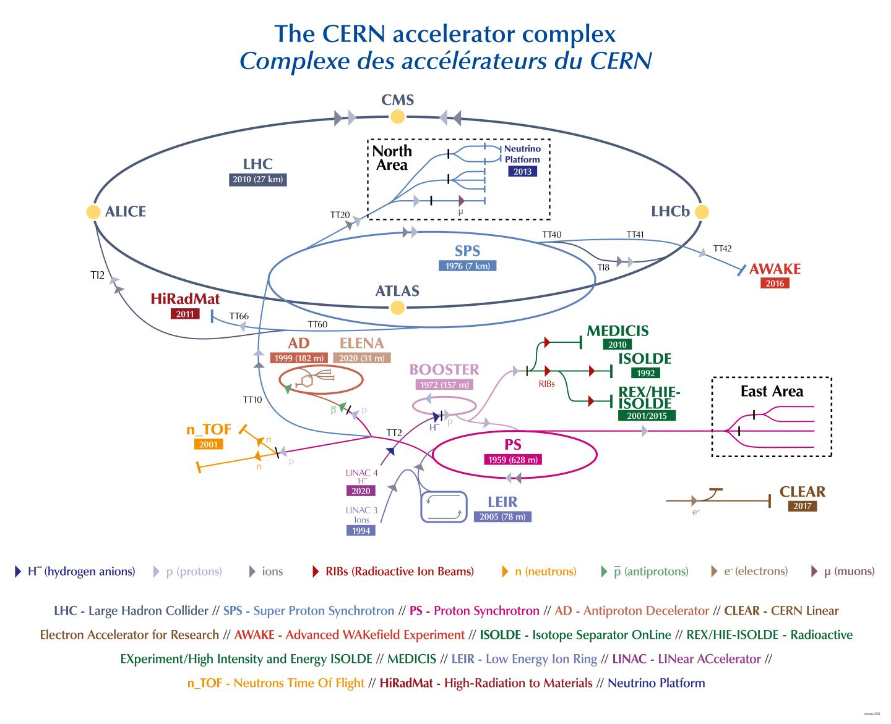
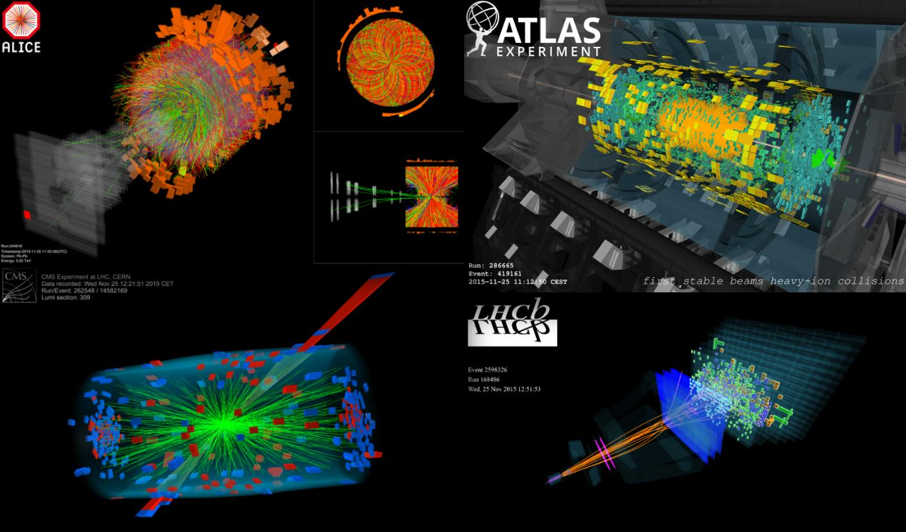

# Large Hadron Collider

The Large Hadron Collider (LHC) at CERN is a circular
particle accelerator with a circumference of approximately
27 km.

It accelerates two counter-rotating beams of particles
before bringing them into collision at designated
interaction points.

## Accelerator complex

Particles are accelerated through several stages before
being injected into the LHC.

For protons, the main acceleration chain consists of
Linac4, the Proton Synchrotron Booster (PSB), the
Proton Synchrotron (PS), and the Super Proton Synchrotron
(SPS).

<figure markdown="span">
    { width="800" }
    <figcaption>
        Figure 1: The CERN accelerator complex, layout in 2022.
        [Source: CERN](https://cds.cern.ch/record/2800984).
    </figcaption>
</figure>

## Experiments at the LHC

The counter-rotating particle beams are brought into
collision at designated interaction points along the
accelerator ring.

The particles produced in these collisions are measured
by different detector systems, allowing the underlying
physical processes to be reconstructed.

### Major experiments

| Experiment | Primary research objectives |
| --- | --- |
| **ALICE** | Heavy-ion physics, QCD and quark-gluon plasma |
| **ATLAS** | Higgs physics, Standard Model measurements and searches for new physics |
| **CMS** | Higgs physics, precision measurements and searches beyond the Standard Model |
| **LHCb** | Heavy-flavour physics, CP violation and rare decays |

ATLAS and CMS are general-purpose experiments, whereas
ALICE and LHCb focus on more specialised research programmes.

<figure markdown="span">
    { width="750" }
    <figcaption>
        Figure 2: Collision events recorded by ALICE,
        ATLAS, CMS and LHCb in 2026.
        [Source: CERN](https://home.cern/final-collisions-new-horizons/).
    </figcaption>
</figure>

### Collision systems

The LHC enables the investigation of different physical
processes through various collision systems.

=== "Proton–proton"

    Proton–proton (pp) collisions are used to study
    fundamental particle interactions, perform precision
    measurements and search for new particles.

=== "Lead–lead"

    Lead–lead (Pb–Pb) collisions allow the investigation
    of strongly interacting matter under extreme
    conditions, including the formation and properties
    of the quark-gluon plasma.

=== "Proton–lead"

    Proton–lead (p–Pb) collisions provide an important
    reference system for investigating nuclear effects
    and understanding the properties of small
    collision systems.

## Further reading

- [Large Hadron Collider](https://home.cern/science/accelerators/large-hadron-collider/)
- [CERN accelerator complex](https://home.cern/science/accelerators/accelerator-complex/)
- [Experiments at CERN](https://home.cern/science/experiments/)
- [ALICE Collaboration](https://alice.cern/)
- [ATLAS Collaboration](https://atlas.cern/)
- [CMS Collaboration](https://cms.cern/)
- [LHCb Collaboration](https://lhcb.cern/)
