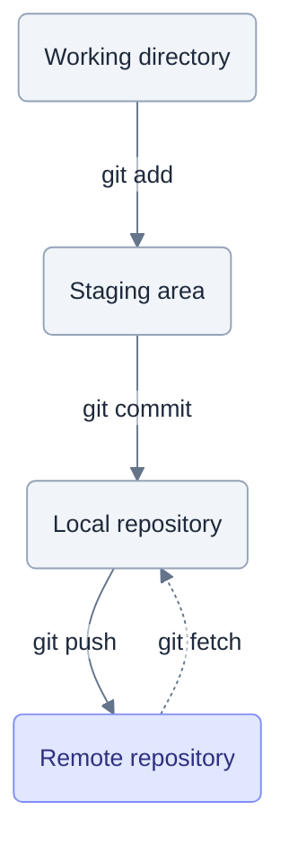
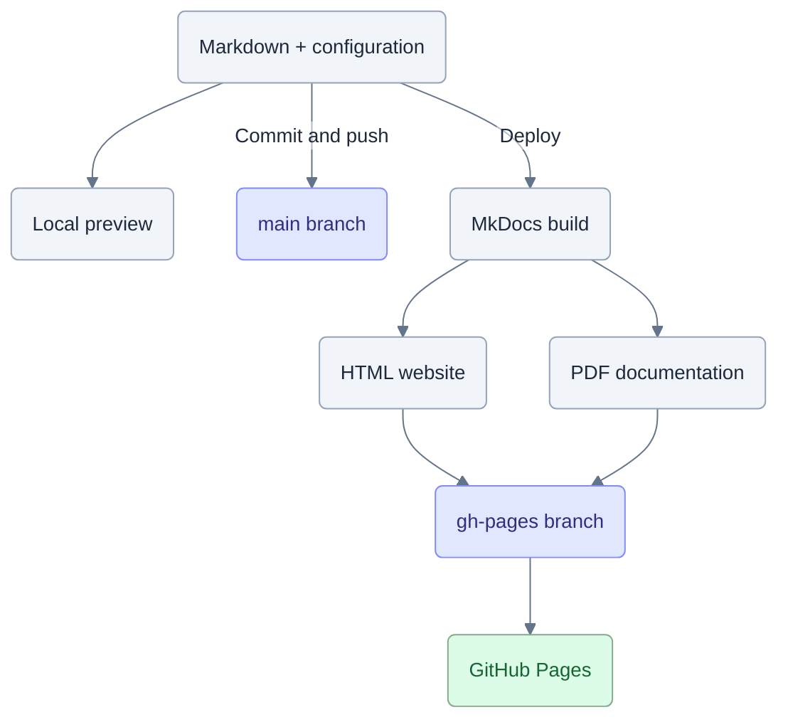

# Git & Version Control

Git is a distributed version control system that records
changes in project files and enables reproducible software
development.

In scientific computing, it allows analysis code to be
tracked, compared and restored throughout a project.

## Repository structure

Git distinguishes between four principal components:

| Component | Purpose |
| --- | --- |
| Working directory | Files currently being edited |
| Staging area | Changes selected for the next commit |
| Local repository | Recorded commits and project history |
| Remote repository | Shared repository hosted on a server |

## Git workflow

Changes are prepared locally, committed and subsequently
synchronized with a remote repository.



!!! note "Fetch versus pull"
    `git fetch` retrieves remote commits without integrating
    them into the current branch.

    `git pull` fetches remote changes and integrates them
    into the current branch.

## Command reference

| Command | Function |
| --- | --- |
| `git clone` | Create a local copy of a repository |
| `git status` | Inspect the repository state |
| `git add` | Stage changes |
| `git commit` | Record staged changes |
| `git push` | Publish local commits |
| `git fetch` | Retrieve remote commits |
| `git pull` | Retrieve and integrate remote changes |
| `git diff` | Inspect changes |
| `git log` | Display commit history |

## Automated documentation deployment

This website separates its source files from the generated
documentation using two Git branches.

- `main`: Markdown files, configuration and scripts.
- `gh-pages`: Generated HTML, assets and PDF documentation.



## Development and deployment

### Local development

```bash
mkdocs serve
```

### Generate the complete documentation

```bash
ENABLE_PDF_EXPORT=1 mkdocs build
```

### Publish changes

```bash
git add .
git commit -m "Update documentation"
git push
ENABLE_PDF_EXPORT=1 mkdocs gh-deploy
```

!!! tip "Development workflow"
    PDF generation is disabled during normal development
    to reduce build times. It is enabled explicitly when
    generating or deploying the complete documentation.
